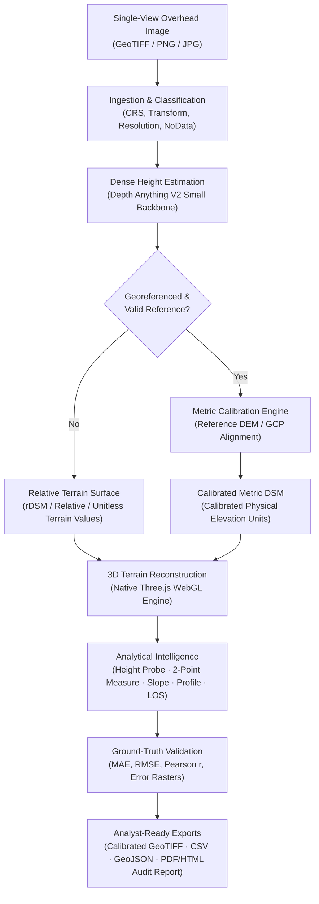

# DEPTHWIZARD

### Single-View Height Estimation & 3D Terrain Analysis

> *"Turning a single optical image into a measurable, navigable terrain environment."*

**Smart India Hackathon 2026 · Problem Statement 26175**

<!-- TODO: Hero Screenshot — 3D Terrain Visualization in Solid and Wireframe (docs/assets/hero_terrain_viewport.png) -->

---

## 1. What is DepthWizard?

**DepthWizard** is a technical geospatial application that transforms single-view overhead optical imagery into dense elevation data and an interactive 3D terrain environment for structural height inspection, slope assessment, topographic analysis, independent validation, and analyst-ready export.

DepthWizard is **not** merely a monocular depth model demo or an AI wrapper. The underlying neural depth estimator is one component inside an integrated, modular geospatial workflow:

$$\text{Single Optical Image} \longrightarrow \text{Height Estimation} \longrightarrow \text{Geospatial Anchoring} \longrightarrow \text{3D Reconstruction} \longrightarrow \text{Analytical Intelligence} \longrightarrow \text{Validation} \longrightarrow \text{Export}$$

By maintaining a strict architectural boundary between **analytical data** (raw floating-point height arrays, map projections, physical coordinates) and **visual rendering** (adaptive heightfield meshing, bilateral smoothing, Three.js shaders), DepthWizard preserves scientific data integrity while delivering real-time, interactive exploration.

---

## 2. Product Pipeline



---

## 3. Product Visuals

The DepthWizard interface is designed as an analyst workspace centered around a native Three.js 3D viewport, contextual inspection hierarchy, and analytical measurement overlays.

| Visual Inspection | Description |
| :--- | :--- |
| <!-- TODO: [Screenshot A] 3D Wireframe Terrain (docs/assets/screenshot_wireframe.png) --> | **Analytical Wireframe Mesh:** Technical slate-colored wireframe rendering across the full terrain grid, enabling immediate structural topology and building contour verification. |
| <!-- TODO: [Screenshot B] Image Ingestion & Metadata (docs/assets/screenshot_ingestion.png) --> | **Geospatial Ingestion Modal:** Automatic classification of CRS, bounding coordinates, pixel resolution (GSD), and NoData masking prior to estimation. |
| <!-- TODO: [Screenshot C] Solid 3D Terrain & RGB Draping (docs/assets/screenshot_solid_rgb.png) --> | **Solid Geological Surface:** Continuous relative or metric heightfield textured with optical imagery, featuring smooth vertex normals and restrained natural relief. |
| <!-- TODO: [Screenshot D] Contextual Inspection & Analysis (docs/assets/screenshot_analysis.png) --> | **Terrain Intelligence & Measurement:** Active point height probe, 3D Euclidean distance measurement, Horn 3×3 slope gradients, and line-of-sight obstruction detection. |
| <!-- TODO: [Screenshot E] Reference Validation & Audit Export (docs/assets/screenshot_validation.png) --> | **Independent Validation Panel:** Co-registered ground-truth comparison showing absolute error maps, residual distribution, and exportable PDF audit documentation. |

---

## 4. SIH Problem Statement & Geospatial Solution

### The Challenge (SIH 2026 · PS 26175)
Traditional digital surface model (DSM) generation relies heavily on stereo satellite pairs, multi-pass photogrammetry, or LiDAR scanning. These methods are computationally intensive, costly, and dependent on multiple acquisitions. Problem Statement 26175 requires extracting 3D elevation and structural heights from a **single overhead optical image** and visualizing the reconstructed landscape in an interactive, navigable 3D environment for defense, disaster management, and urban planning.

### The DepthWizard Solution
DepthWizard bridges the gap between monocular deep learning and operational Geographic Information Systems (GIS):
1. **End-to-End Workflow:** Solves the entire pipeline from raw raster ingestion to standards-compliant GeoTIFF and PDF report generation.
2. **Scientific Guardrails:** Rejects false metric certainty by clearly separating uncalibrated **Relative Terrain (rDSM)** from calibrated **Metric Terrain (DSM)**.
3. **Analyst Tooling:** Delivers real-time interactive terrain inspection (height probing, profile slicing, line-of-sight analysis) directly on the reconstructed 3D mesh.

---

## 5. System Architecture

```text
DepthWizard
├── FRONTEND (React 18 + Vite 5 + TypeScript)
│   ├── WorkspaceShell & Contextual Inspection Panel
│   ├── Native Three.js WebGL Engine (TerrainMesh, CameraPresets, OrbitControls, FirstPerson)
│   ├── Analytical Visual Pipeline (Bilinear Resampling, Bilateral Smoothing, Colormaps)
│   └── GeoTIFF Parser & Client-Side Raster Ingestion
│
├── BACKEND (FastAPI + Python 3.11 + Uvicorn)
│   ├── REST API Layer (/api/depth, /api/calibrate, /api/terrain/*, /api/export/*)
│   ├── Model Provider Factory (da2_zero_shot, da2_fine_tuned)
│   ├── Terrain Intelligence Engine (Horn 3×3 Slope, Aspect, Hillshade, Profile Slicer, LOS)
│   ├── Calibration & Alignment Engine (DEM Providers, Affine Transformations, Least-Squares Fit)
│   └── Production Export Engine (Rasterio GeoTIFF, GeoJSON, CSV, ReportLab/PyMuPDF PDF)
│
└── MACHINE LEARNING (PyTorch + Hugging Face Transformers)
    ├── Depth Anything V2 Small Backbone (DINOv2 Feature Extractor)
    └── Overhead Remote-Sensing Height Adaptation Head
```

---

## 6. Machine Learning Approach

Monocular depth models trained on internet perspective photography struggle with overhead nadir perspectives, orthographic scale ambiguity, and terrain elevation dynamics. DepthWizard employs a domain-adapted dense regression architecture.

### Current Experimental Configuration

```text
Base Backbone:        Depth Anything V2 Small
Feature Extractor:    DINOv2 (Frozen)
Prediction Head:      DPT Decoder / DA2 Neck (Fine-tuned)
Task Formulation:     RGB → Above-Ground Level (AGL) / Relative Height Dense Map
Training Base:        GAMUS Remote Sensing Dataset (Paired Overhead RGB + Height Rasters)
Loss Formulation:     Log-transformed L1: L = |log1p(pred) - log1p(target)|
```

### Parameter Allocation

| Component | Status | Parameter Count | Percentage |
| :--- | :--- | :--- | :--- |
| **DINOv2 Backbone** | Frozen | 22,056,576 | 89.0% |
| **DA2 Neck & Depth Head** | Trainable | 2,728,513 | 11.0% |
| **Total Model Architecture** | — | **24,785,089** | **100.0%** |

*Note: This configuration represents the current experimental checkpoint evaluated within the project.*

---

## 7. Experimental Validation

### GAMUS Held-Out Validation
The domain-adapted model was evaluated against an independent, held-out test split of the GAMUS dataset consisting of overhead optical tiles and ground-truth LiDAR/photogrammetric heightfields:

- **Validation Split:** 30 held-out evaluation tiles
- **Sampled Pixels:** 7,857,200 valid non-masked height pixels

| Evaluation Metric | Baseline (Zero-Shot DA-V2) | Baseline (Spatial Mean) | DepthWizard Adapted Checkpoint |
| :--- | :--- | :--- | :--- |
| **Mean Absolute Error (MAE)** | 10.18 m | 5.49 m | **3.03 m** |
| **Root Mean Squared Error (RMSE)** | 11.76 m | 6.63 m | **4.65 m** |
| **Pearson Correlation ($r$)** | -0.1996 | 0.0000 | **+0.884** |
| **Spearman Rank Correlation ($\rho$)** | -0.0390 | 0.0000 | **+0.875** |

> [!IMPORTANT]
> **Scientific Scope of Metrics:**
> These figures represent held-out validation on the GAMUS evaluation benchmark under standardized conditions. They must **not** be interpreted as universal satellite accuracy across arbitrary global geography, sensor geometries, or atmospheric conditions. Uncalibrated single-view depth estimation is inherently scale-ambiguous.

---

## 8. Relative vs. Metric Terrain

A core scientific guardrail in DepthWizard is preventing false metric certainty:

```text
       Input Image Ingestion
                 │
      ┌──────────┴──────────┐
      ▼                     ▼
[Standard JPG/PNG]    [Georeferenced GeoTIFF]
      │                     │
      ▼                     ▼
RELATIVE TERRAIN      Reference DEM / GCPs?
(Relative / Unitless)       │
                      ┌─────┴─────┐
                      ▼           ▼
                   [Available]  [Missing / Invalid]
                      │           │
                      ▼           ▼
               METRIC TERRAIN   CALIBRATION REJECTED
               (Calibrated)     (Reverts to Relative)
```

### Canonical Terrain States
The application explicitly tracks and displays one of three states across the header, 3D canvas, inspector, and exported reports:

1. **`RELATIVE TERRAIN` (rDSM):** Default for standard images (JPG, PNG) or unreferenced GeoTIFFs. Elevation values are reported in relative / unitless terrain values representing surface relief and structural variance without fabricating physical metres.
2. **`METRIC TERRAIN` (DSM):** Activated only when georeferenced raster metadata and a co-registered reference source (such as SRTM, CartoDEM, or ground control points) provide an empirical calibration fit. Elevation is reported in calibrated physical elevation units when valid reference and calibration information are available.
3. **`CALIBRATION REJECTED`:** When calibration fails its configured quality checks, metric calibration is rejected and the relative terrain state is retained.

---

## 9. Terrain Analysis Capabilities

DepthWizard includes a suite of quantitative measurement and terrain inspection tools:

* **3D Orbit & First-Person Navigation:** 3D orbit navigation, camera orientation presets, and first-person terrain navigation.
* **Solid & Wireframe Surface Modes:** Instant toggle between photographic RGB texturing, analytical colormaps, and a 1px technical wireframe grid for inspecting structural breaks and facet geometry.
* **Multi-Layer Analytical Shading:** Real-time on-mesh rendering of:
  * **Elevation Colormap:** Perceptually uniform elevation gradients.
  * **Horn 3×3 Slope:** Physical gradient steepness ($0^\circ - 90^\circ$).
  * **Analytical Hillshade:** Multi-directional illumination highlighting ridges and escarpments.
* **Point Height Probe:** Raycasts to surface geometry and returns sampled surface location, raster indices, relative/metric elevation, and local slope.
* **Two-Point 3D Measurement:** Calculates direct 3D Euclidean distance, planar horizontal distance, and vertical elevation difference ($\Delta h$) between two interactive surface pins.
* **Cross-Section Profile Slicing:** Extracts continuous elevation transects between arbitrary endpoints, plotting topographical elevation profiles with min/max/mean metrics.
* **Line-of-Sight (LOS) Analysis:** Evaluates optical line-of-sight between observer and target pins with configurable observer/target height offsets, detecting terrain obstructions and marking the first blocking point.
* **Terrain Suitability Screening:** Binary threshold screening identifying buildable slopes or non-flood zones with color-coded overlays.

---

## 10. Geospatial Awareness & Data Integrity

DepthWizard preserves GIS standards throughout its execution:
- **Raster Metadata Preservation:** Ingests and preserves Coordinate Reference Systems (CRS: UTM, WGS84, etc.), affine geotransforms, bounding extents, and native pixel resolutions (GSD).
- **NoData Masking:** Identifies and propagates missing data pixels through estimation and analytical filters without corrupting surface geometry.
- **Strict Pipeline Separation:** Raw floating-point arrays are maintained independently from the Three.js display buffer. Measurement and export routines always operate on the authoritative analytical grid.
- **Standards-Compliant Exports:**
  - **Calibrated GeoTIFF:** 32-bit floating-point elevation raster with embedded CRS and affine transform.
  - **Signed Error GeoTIFF:** Spatial error map comparing model output against reference data.
  - **Measurement GeoJSON & CSV:** Vector geometries, line transects, and profile points.
  - **Audit PDF / HTML Reports:** Executive documentation containing session metadata, input specifications, statistical distributions, and tool measurement logs.

---

## 11. Technology Stack

### Frontend
- **Framework:** React 18.3.1 + TypeScript 5.6.3
- **Bundler:** Vite 5.4.11
- **3D Graphics Engine:** Three.js 0.186.0 (WebGLRenderer, BufferGeometry, MeshStandardMaterial)
- **Styling:** Tailwind CSS 3.4.15 + PostCSS + Autoprefixer
- **Icons & Animation:** Lucide React 0.468.0, Motion 13.2.0
- **Client Raster Ingestion:** geotiff.js 3.0.5

### Backend
- **Web API:** FastAPI 0.135.1 + Uvicorn 0.41.0
- **Validation & Serialization:** Pydantic 2.12.5, python-multipart 0.0.22
- **Scientific Computing:** NumPy 2.4.3, SciPy 1.17.1
- **Image Processing:** Pillow 12.1.1, OpenCV (opencv-python) 4.10.0.84
- **Geospatial & Projections:** Rasterio 1.4.4, PyProj 3.7.2, Affine 3.0.1
- **Report Generation:** PyMuPDF (fitz) 1.27.2

### Machine Learning
- **Deep Learning Framework:** PyTorch 2.14.0 (CUDA / MPS / CPU)
- **Model Architecture:** Depth Anything V2 Small (DINOv2 backbone)
- **Model Distribution:** Hugging Face Transformers 5.17.0, Safetensors 0.8.0

---

## 12. Quick Start

### Prerequisites
- **Python 3.11+**
- **Node.js 18+** and **npm**
- **Git**

### Installation

```bash
# 1. Clone repository
git clone https://github.com/Mrityunjaykkk/DepthWizard.git
cd DepthWizard

# 2. Configure Python Virtual Environment
python -m venv .venv

# Activate on Windows:
.venv\Scripts\activate
# Activate on Linux/macOS:
# source .venv/bin/activate

# Install backend dependencies
pip install -r requirements.txt

# 3. Configure Frontend
cd frontend
npm install
npm run build
cd ..
```

### Running DepthWizard

Start the unified application backend (serves both API and production workspace UI):

```bash
# Start backend server
python -m backend.main
```

Open your browser and navigate to:
```text
http://127.0.0.1:8000/workspace
```

*For active frontend UI development with hot-module reload:*
```bash
# Terminal 1: Backend
python -m backend.main

# Terminal 2: Frontend dev server
cd frontend
npm run dev
# Open http://localhost:5173
```

---

## 13. Project Structure

```text
DepthWizard/
├── backend/                        # FastAPI Python backend
│   ├── app.py                      # REST endpoints & request lifecycle
│   ├── config.py                   # Model & server configurations
│   ├── main.py                     # Server entrypoint
│   ├── calibration/                # Reference DEM alignment & GCP fitting
│   ├── estimators/                 # Model provider registry & DA2 loaders
│   ├── export/                     # GeoTIFF, CSV, GeoJSON, & PDF report generators
│   ├── schemas/                    # Pydantic request/response contracts
│   ├── terrain/                    # Slope, aspect, hillshade, LOS, & QA engines
│   └── utils/                      # Binary serialization & buffer utilities
│
├── frontend/                       # React + TypeScript + Three.js application
│   ├── src/
│   │   ├── components/workspace/  # Workspace shell, header, inspector, modals
│   │   │   └── terrain/            # Native Three.js adapter, mesh, camera, controls
│   │   ├── state/                  # WorkspaceContext application state
│   │   ├── types/                  # TypeScript interface contracts
│   │   └── App.tsx                 # Root application component
│   ├── package.json                # Frontend dependencies & build scripts
│   └── vite.config.ts              # Vite configuration
│
├── docs/                           # Authoritative project documentation
│   ├── architecture/               # Frontend, backend, & ML integration specs
│   ├── decisions/                  # Architectural decision log (D-001 - D-010)
│   ├── design/                     # Design system & interaction guidelines
│   ├── engineering/                # API contracts, requirements, & deployment
│   ├── ml/                         # Training pipeline & validation protocols
│   └── product/                    # Capability maps & user flows
│
├── tests/                          # Pytest test suite (126 unit/integration tests)
├── requirements.txt                # Pinned Python package dependencies
└── README.md                       # Repository documentation
```

---

## 14. Scientific Scope & Limitations

* **Monocular Scale Ambiguity:** A single 2D image does not contain intrinsic physical scale. Without camera intrinsics, metadata, ground control points, or reference elevation models, outputs are fundamentally relative elevation models.
* **Geographic & Sensor Generalization:** Current fine-tuning benchmarks are grounded in the GAMUS overhead dataset. Quantitative performance on extreme mountain topography, desert sandscapes, dense multi-canopy tropical rainforests, or high-oblique satellite captures has not yet been established.
* **Edge & Tree Canopy Penetration:** Optical height estimation captures surface reflections (Digital Surface Model / DSM), not bare earth (Digital Elevation Model / DEM). Dense vegetation canopy height will reflect canopy tops rather than underlying ground.
* **Physical Cross-Check Scope:** Shadow length geometry provides useful physical plausibility checks only when solar elevation, azimuth, and reliable shadow segmentations exist; it is an auxiliary reliability signal rather than a primary estimator.

---

## 15. Project Status

| Functional Domain | Implementation Capability | Status |
| :--- | :--- | :--- |
| **3D Visualization** | Native Three.js WebGL terrain engine with visual heightfield resampling | **DONE** |
| **Geometry Rendering** | Solid surface, 1px technical wireframe, and multi-layer analytical shading | **DONE** |
| **Navigation** | 3D Orbit, camera orientation presets (`TOP`, `N`, `S`, `E`, `W`), First-Person flythrough | **DONE** |
| **Terrain Intelligence** | Point probe, two-point distance, Horn 3×3 slope, cross-section slicing, LOS | **DONE** |
| **Geospatial Ingestion** | GeoTIFF, PNG, JPG ingestion with CRS, extent, and NoData extraction | **DONE** |
| **State Guardrails** | Explicit `RELATIVE TERRAIN`, `METRIC TERRAIN`, `CALIBRATION REJECTED` enforcement | **DONE** |
| **Export & Reporting** | 32-bit float GeoTIFF, signed error raster, CSV profiles, PDF & HTML audit reports | **DONE** |
| **Independent Validation** | Pixel-wise error analysis and validation against reference rasters (when reference available) | **DONE** |
| **ML Elevation Estimation** | Fine-tuned Depth Anything V2 Small overhead remote-sensing model | **EXPERIMENTAL** |
| **Automated DEM Calibration** | Co-registration and least-squares polynomial surface fitting | **EXPERIMENTAL** |
| **Satellite Generalization** | Cross-sensor fine-tuning across diverse multi-spectral satellite constellations | **IN PROGRESS** |
| **Cloud-Distributed Scaling**| Containerized GPU multi-worker cluster orchestration | **FUTURE** |

---

## 16. Smart India Hackathon Information

* **Hackathon:** Smart India Hackathon 2026
* **Problem Statement:** PS 26175 — Single-View Height Estimation & 3D Terrain Visualization
* **Focus Area:** Geospatial Analytics, Computer Vision, Remote Sensing, Interactive 3D Visualization

---

## 17. Acknowledgements

The DepthWizard project builds upon foundational open-source technologies, models, and scientific research:
- [Depth Anything V2](https://github.com/DepthAnything/Depth-Anything-V2) by TikTok & HKU for the monocular depth foundation backbone.
- [DINOv2](https://github.com/facebookresearch/dinov2) by Meta AI Research for vision transformer representations.
- **GAMUS Dataset** for overhead remote-sensing height training pairs.
- [Three.js](https://threejs.org/) for native WebGL 3D graphics rendering.
- [FastAPI](https://fastapi.tiangolo.com/) and [Uvicorn](https://www.uvicorn.org/) for the high-performance async backend.
- [Rasterio](https://rasterio.readthedocs.io/) and [GDAL](https://gdal.org/) for geospatial raster manipulation and projection transformations.
